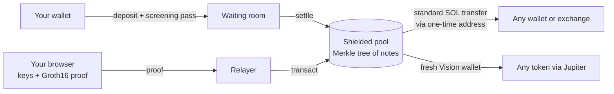

<p align="center">
  
</p>

<h1 align="center">VisionSwap</h1>

<p align="center">
  <b>A zero-knowledge shielded pool on Solana, live on mainnet.</b><br />
  Private SOL transfers to any address, and private trading of any Solana token.
</p>

<p align="center">
  <a href="https://visionswap.net">visionswap.net</a> ·
  <a href="https://visionswap.net/docs">Docs</a> ·
  <a href="https://x.com/VisionSwapSol">@VisionSwapSol</a> ·
  Program <code>VSwJY1r9S7nNUyvBzWYr1rBkEMyTAjDFGtixxLGpmt6</code>
</p>

---

## What it does

VisionSwap brings the note-and-nullifier design pioneered by Zcash to Solana. You **shield** SOL into a pool, and from then on you can:

- **Send privately** to any wallet or exchange. The recipient gets a standard SOL transfer from a one-time address, so exchanges credit it like any deposit.
- **Pay straight from your wallet in one step.** The app shields exactly what the payment needs, then sends it privately once it joins the pool.
- **Trade any token privately.** Each buy lands in a fresh "Vision wallet" funded from the pool, with nothing on-chain tying it to you. Spread one token across several wallets, or sell from all of them at once.
- **Run private orders:** limit buys, DCA, multi-step take-profits, stop-losses and trailing stops.
- **Schedule payments** for a random moment, split them across recipients, or share a payment link.

## Why it does not leak

| | How |
| --- | --- |
| **No link from deposit to spend** | Balances are Poseidon note commitments in an on-chain Merkle tree (depth 26). A spend reveals only nullifiers and new commitments, never which notes it consumed. |
| **Keys never leave the device** | Spending and viewing keys are derived in the browser. Groth16 proofs (BN254) are generated client-side; no server can create, change or spend them. |
| **The relayer can't cheat** | The proof binds the recipient, the amount, the relayer and the fees (`extDataHash`). The relayer only submits it, so the user's wallet never signs or pays for the spend. |
| **The recipient sees a clean payment** | Payouts to outside addresses arrive as one standard SOL transfer from a one-time address derived from the user's own key. |
| **Nobody else can read your notes** | Each note's metadata is masked with a key-derived pad. Clients download every leaf and find their own locally, so no server learns which notes are whose. History is shared only through an optional viewing key. |
| **Timing is not a giveaway** | Scheduled payments go out at a random moment inside a window; multi-wallet actions are paced with random gaps and slightly varied amounts. |

**Public by design** (like Zcash's transparent-to-shielded and shielded-to-transparent edges): the depositing address and amount, and withdrawal amounts and recipients. Every new deposit waits briefly in an on-chain waiting room while it is screened against sanctions lists, together with the wallets that funded it; a flagged deposit can only ever go back to where it came from.

## What is real

Everything. There are no mocks, simulators or test doubles in production.

- The Anchor program in [`program/`](program/) is deployed on Solana mainnet and verifies Groth16 proofs on-chain.
- The Circom circuit in [`circuits/`](circuits/) (2 inputs, 2 outputs) and its proving artifacts are the ones the live site uses.
- The relayer, indexer, deposit screening, settle crank, order keeper and send-later scheduler in [`server/`](server/) run in production.
- The web app in [`web/`](web/) is what [visionswap.net](https://visionswap.net) serves.

### Verify it yourself

- **The deployed program matches this code.** `https://visionswap.net/api/health` publishes the on-chain program's SHA-256. Build with `program/scripts/build.sh` and compare, or dump the program with `solana program dump VSwJY1r9S7nNUyvBzWYr1rBkEMyTAjDFGtixxLGpmt6 out.so`.
- **The proving key matches the circuit.** `circuits/artifacts/TRANSCRIPT.json` records every step of the setup and the hashes of the final key; check it with `snarkjs zkey verify`.
- **The pool's settings are on-chain.** `https://visionswap.net/api/pool/info` mirrors the config account: fee (capped at 1% by the program), limits, waiting room and screening.

## How it works



- **Deposit (proof-free):** the depositor sends `amount` and `inner = Poseidon(pubKey, blinding)`; the program computes the leaf itself after the waiting room (`settle`). Until then the depositor, or the screening guard, can send it back to the depositor only (`refund`).
- **Spend:** `transact` verifies a Groth16 proof with public inputs `root, -withdraw, extDataHash, nullifier[2], commitment[2]`, records both nullifiers, pays the recipient, relayer fee and pool fee from the vault, and appends the two output commitments.
- **Keys:** derived from the user's wallet signature over a fixed message, so there is no new seed phrase; accounts can also be opened with a private key or a passkey.
- **Orders:** each order has its own key; the Vision wallet approves it for exactly the order's amount, and the keeper signs a Jupiter swap that pays back into the same wallet. Order state is sealed at rest and each order key is deleted when the order ends.

The full protocol, fees and screening rules are in [the docs](https://visionswap.net/docs).

## Trust model

- **Non-custodial:** settled funds move only with a valid proof. There is no admin withdrawal, and no admin setting can redirect a payment.
- **Upgradeable program:** the program can still be upgraded by its upgrade authority. The published fingerprint above lets anyone confirm what is deployed at any time.
- **Trusted setup:** phase 1 is the PSE Perpetual Powers of Tau (80 contributions). Phase 2 has three contributions made by the VisionSwap team in one setup run, sealed with a beacon from Bitcoin block 969748. A public multi-party phase 2 is planned.
- **Audit:** tested end to end (deposits, refunds, settlement, spends, double-spend and tamper attempts, fee caps, griefing), not yet independently audited.

## Repository

| Folder | What it is | License |
| --- | --- | --- |
| [`program/`](program/) | Anchor program: vault, waiting room, Merkle tree, Groth16 verifier, fees | Apache-2.0 |
| [`circuits/`](circuits/) | Circom transaction circuit, trusted-setup scripts and artifacts | GPL-3.0 |
| [`sdk/`](sdk/) | TypeScript: keys, notes, tree, proofs, transaction builders, events | Apache-2.0 |
| [`server/`](server/) | Indexer, relayer, screening guard, settle crank, order keeper, scheduler, RPC gateway | Apache-2.0 |
| [`web/`](web/) | Landing page, app, exposure check and docs (React, Vite, three.js) | GPL-3.0 |
| [`ops/`](ops/) | Key creation, go-live and admin tools | Apache-2.0 |

## Run it locally

Requires Node.js 22.13+ (and WSL with the Solana and Anchor toolchains to build the program).

```bash
npm install
npm test                         # sdk, server and web unit tests (including a real proof)
npm run dev -w server            # API on :8787 (see server/.env.example)
npm run dev -w web               # app on :5196
```

Build the program inside WSL with `program/scripts/build.sh [PROGRAM_ID]`; `program/scripts/localnet.sh` starts a local validator with it. Running your own deployment: [`START-HERE.md`](START-HERE.md). Release history: [`docs/RELEASE-NOTES.md`](docs/RELEASE-NOTES.md).

## Security

Please report vulnerabilities privately through GitHub's **Report a vulnerability** (Security tab) rather than in a public issue. See [`SECURITY.md`](SECURITY.md).
